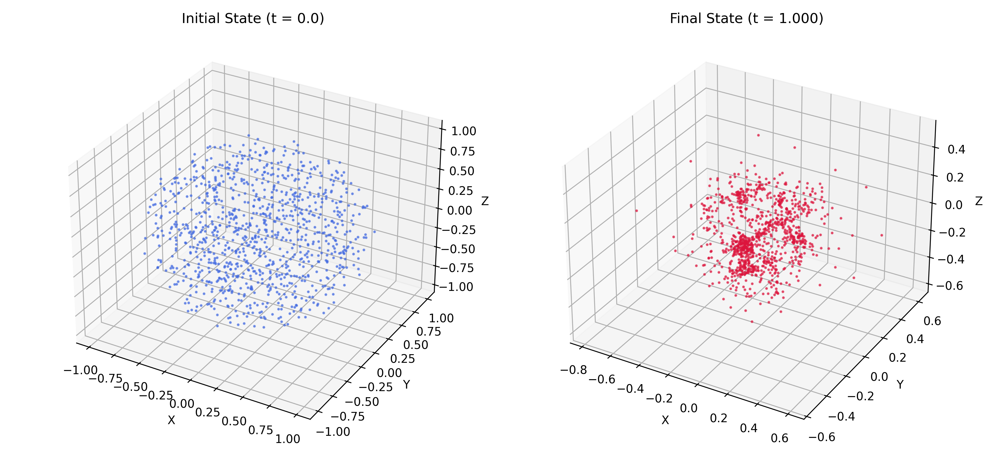
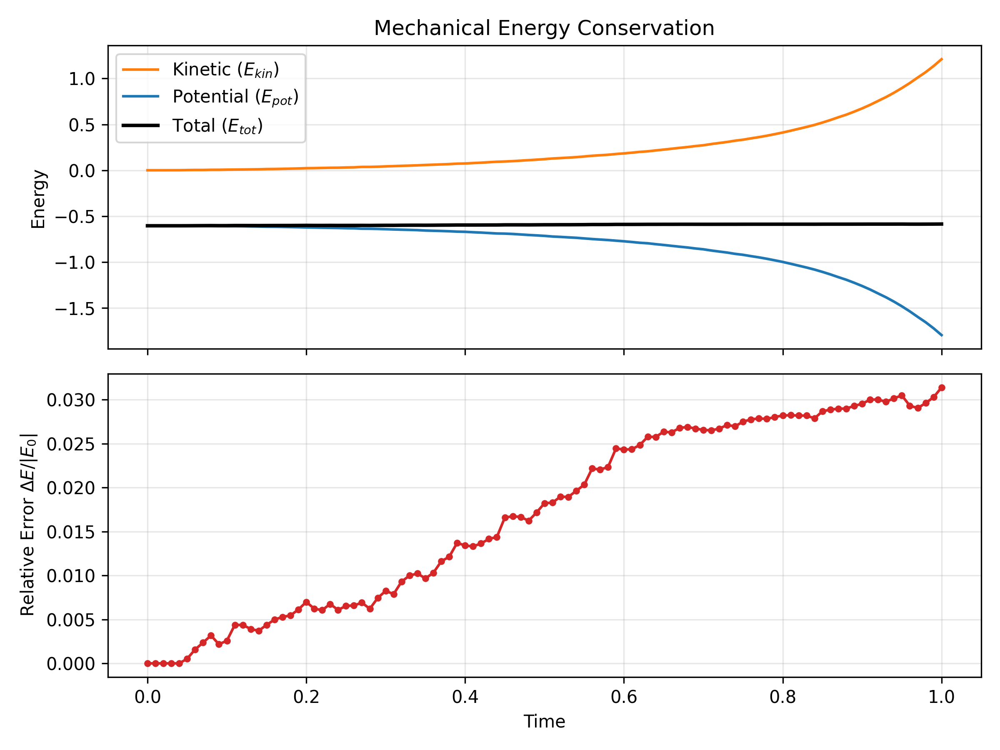

# Direct N-Body Simulation parallelised with OpenMP

This project implements an N-body simulation programmed in Fortran 90 using the leapfrog integrator. The code computes the gravitational forces between $N$ particles and advances their positions and velocities over time. The acceleration calculations have been parallelised using OpenMP to significantly reduce runtime for large $N$ and take advantage of current multi-threaded CPUs.

## Compilation

The project uses a `Makefile` to handle dependencies (compiling the `kinds`, `geometry`, and `particle` modules first). It builds both a standard serial executable and an OpenMP-enabled executable, to be able to compare later on the running times for both scenarios.

To compile the project, just run:
```bash
make
```
This generates two executables: `ex1` (serial) and `ex1_omp` (parallel). 
To clean up the compiled `.o` and `.mod` files, you can run `make clean`.

## Generating Initial Conditions

To generate a custom initial state for the simulation, you can compile and run `random_sphere.f90`. This program creates a specified number of particles ($N$) uniformly distributed within a sphere of radius 1.0, initially at rest.

Compile the generator directly using `gfortran` (it does not require the project modules):

```bash
gfortran -Wall -O2 -o random_sphere random_sphere.f90

```

Run the generator by passing the desired number of particles and a random seed as command-line arguments, and redirect the output to a `.dat` file:

```bash
./random_sphere 1000 1126 > my_sphere.dat

```

This creates `my_sphere.dat` containing the standard simulation header (time step, output interval, end time, and $N$) followed by the mass and initial position/velocity vectors for all $N$ particles, ready to be passed into `./ex1` or `./ex1_omp`.

## How to Run

The executables require an input file containing the simulation setup (time step, output interval, end time, particle count, and initial state vectors) passed as a command-line argument. An optional second argument (`energy`) can be passed to compute and log mechanical energy conservation diagnostics:

```bash
# Standard run (generates output.dat only)
./ex1 input.dat
./ex1_omp input.dat

# Diagnostic run (generates both output.dat and energy.dat)
./ex1_omp input.dat energy
```

The program outputs the simulation state at regular intervals to `output.dat`. Each line contains the time followed by the consecutive $x$, $y$, and $z$ coordinates of all particles. When the `energy` flag is enabled, the program also writes energy diagnostics at each output step to `energy.dat`. Each time the program is run, it will replace the previous output files.

## Physics Enhancements & Diagnostics

### Gravitational Softening
In direct $N$-body simulations of point masses, close encounters ($r_{ij} \to 0$) cause gravitational forces to diverge, resulting in numerical instabilities and artificial particle ejections due to the finite integration time step $\Delta t$. To prevent division-by-zero singularities while preserving Newtonian behaviour at large distances, a gravitational softening parameter $\epsilon^2 = 10^{-6}$ is introduced into the squared distance calculation:

$$r_{ij}^2 = |\mathbf{r}_j - \mathbf{r}_i|^2 + \epsilon^2$$

### Parallel Energy Conservation Tracking
Because the leapfrog scheme is a symplectic integrator, it is designed to bound global energy errors over long integrations (unlike non-symplectic methods such as Euler's method, which systematically inject energy). To validate the numerical accuracy of the simulation when the `energy` flag is passed, the code computes the total mechanical energy at $t = 0$ and at every output step:

$$E_{\text{tot}} = E_{\text{kin}} + E_{\text{pot}} = \sum_{i=1}^{N} \frac{1}{2} m_i |\mathbf{v}_i|^2 - \sum_{i=1}^{N-1} \sum_{j=i+1}^{N} \frac{m_i m_j}{\sqrt{|\mathbf{r}_j - \mathbf{r}_i|^2 + \epsilon^2}}$$

Both sums are parallelised in pure Fortran 90 using OpenMP scalar reductions (`reduction(+:e_kin)` and `reduction(+:e_pot)`) with dynamic loop scheduling to ensure load balancing across threads without race conditions. The time, kinetic energy, potential energy, total energy, and relative energy drift $\Delta E / |E_0| = (E(t) - E_0) / |E_0|$ are logged in `energy.dat`.

## Cold Sphere Gravitational Collapse Experiment (`run_collapse.sh`)

By default, `random_sphere.f90` initializes $N$ particles uniformly distributed inside a sphere of radius $R = 1.0$ starting from rest ($\mathbf{v}_i = \mathbf{0}$) with a short end time of $t_{\text{end}} = 0.1$ and time step $\Delta t = 0.001$. Because the gravitational free-fall dynamical time of the system is $t_{\text{ff}} \approx 1.1$, evolving the system only up to $t = 0.1$ produces negligible spatial displacement.

To observe the full gravitational collapse and test the symplectic integrator under strong dynamical evolution, the script `run_collapse.sh` automates the following workflow:
1. Generates an initial sphere of $N = 1000$ particles (`sphere_collapse.dat`).
2. Uses `awk` to configure the output interval to $\Delta t_{\text{out}} = 0.01$ (line 2) and extends the simulation end time to $t_{\text{end}} = 1.0$ (line 3), executing $1000$ integration steps and recording $100$ intermediate states.
3. Runs `./ex1_omp sphere_collapse.dat energy` across 8 OpenMP threads.
4. Calls `plot.py` to generate two figures:
   * **`snapshots.png`:** A side-by-side 3D comparison showing the uniform initial sphere at $t = 0.0$ collapsing inward under self-gravity into a dense central core and surrounding halo by $t = 1.0$.

   

   * **`energy_plot.png`:** A two-panel plot showing gravitational potential energy ($E_{\text{pot}}$) dropping sharply as it converts into kinetic energy ($E_{\text{kin}}$) during the infall, while total mechanical energy ($E_{\text{tot}}$) remains conserved. Even during high-density core collapse at $t \to 1.0$, gravitational softening prevents singular force spikes and keeps the relative energy drift bounded within $\sim 3\%$.
   
   
To run the collapse experiment and generate the plots automatically:
```bash
chmod +x run_collapse.sh
./run_collapse.sh
```

## Running time study & OpenMP Parallelisation

A timing study was conducted using particles generated by `random_sphere.f90` to measure how the execution time scales with both the number of particles ($N$) and the number of OpenMP threads.
The values provided below have been obtained by testing with an M2 Pro. Results may vary between different CPUs.

### Run Time (seconds)
| Threads | N = 1000 | N = 2000 | N = 5000 | N = 10000 |
| :--- | :--- | :--- | :--- | :--- |
| **1** | 0.48 | 1.88 | 11.81 | 47.18 |
| **2** | 0.27 | 1.06 | 7.64 | 25.56 |
| **4** | 0.17 | 0.65 | 3.95 | 15.60 |
| **8** | 0.12 | 0.45 | 2.70 | 10.64 |

### Calculated Speed-up relative to 1 thread

| Threads | N = 1000 | N = 2000 | N = 5000 | N = 10000 |
| :------ | :------- | :------- | :------- | :-------- |
| **2**   | 1.78x    | 1.77x    | 1.55x    | 1.85x     |
| **4**   | 2.82x    | 2.89x    | 2.99x    | 3.02x     |
| **8**   | 4.00x    | 4.18x    | 4.37x    | 4.43x     |

The parallelisation strategy yields substantial performance gains, particularly at large particle counts ($N=10000$ drops from 47.18s to 10.64s). The speed-up scales well, achieving roughly a 3.0x speed-up with 4 threads and a 4.4x speed-up with 8 threads on large arrays. The scaling is sub-linear due to OpenMP thread creation/management overhead and memory bandwidth saturation on the CPU. However, even moving from 1 to 2 threads yields around 1.85x speed-up, proving that the computational time saved outweighs the initial overhead cost of dividing the work and managing those threads.

To avoid disk overhead, we have done the benchmark with only one snapshot. This time study can be recreated using the file `run_timing.sh`:

```bash
chmod +x run_timing.sh
./run_timing.sh
```