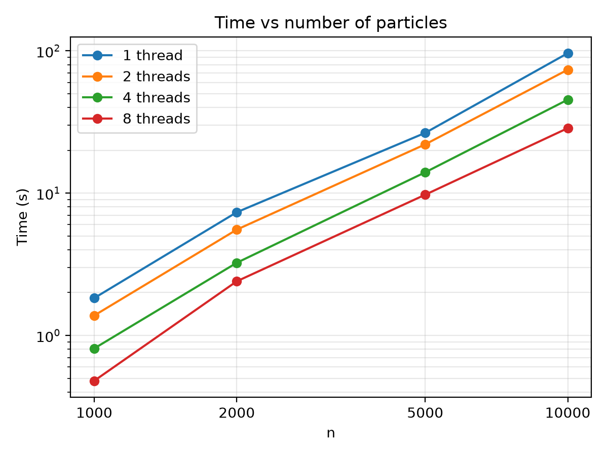
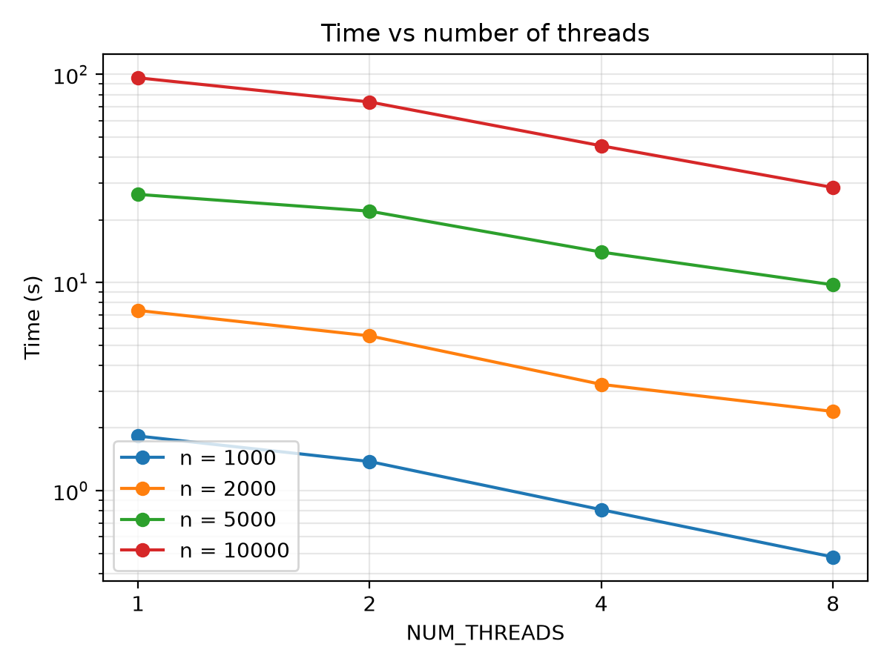

# Main code: ex1

The main code is just a light modification of the original leapfrog.f90 given by professor. I just changed real to double precision reals, introduced the types particle3d, vector3d and point3d for 3-D variables, and parallelised the loop for calculation accelerations. It also calculates and prints on console the time taken by the main process of the simulation: the time evolution; and writes the positions as they evolve on output.dat.

There are several ways to use this program, the main ones being automated and explained on the makefile.

# Makefile

## Commands

- make: this will compile with -fopenmp -O2 by default.
- make plot: this will plot the orbits followed by the particles in output.dat.
- make everything: this one will directly compile, run and plot.
- make clean: actually unlikely to be useful. It will delete everything that was just a requirement for compiling the main program (which is already done by every other command), but is actually useful when an error ocurs.

## Variables

- ENV: not mandatory, but a venv shall be useful for visualization through plot_orbits.py.
- INPUT: this is the name of the input file. By default, it will be input.dat.
- RESULTS: the name of the file to be plotted. By default 'output.dat', but can be changed when giving the make commands as RESULTS="whatever".
- IMAGE: name of the image created by the python script.

## Parallelisation

We can assign the number of threads (for example, 4) in case we run directly with make as

- OMP_NUM_THREADS=4 make everything

And we can change flags, to compile without fopenmp (or whatever other purposes) like

- make everything FLAGS="-O2"

# Results

The seed I used for random_sphere.f90 is 111111111. This program creates random initial conditions of n particles within a sphere. Then, I saved the time it took for each simulation to run, using 1000, 2000, 5000 and 10000 particles, all with 1, 2, 4 and 8 threads for parallelisation. Results are shown in the following two-way table:

### Run time in seconds

|   n    | 1 Thread | 2 Threads | 4 Threads | 8 Threads |
|--------|----------|-----------|-----------|-----------|
| 1000   | 1.83     | 1.38      | 0.81      | 0.4800    |
| 2000   | 7.34     | 5.54      | 3.24      | 2.4010    |
| 5000   | 26.50    | 22.01     | 14.00     | 9.7450    |
| 10000  | 96.22    | 73.67     | 45.36     | 28.6050   |

We can graph time as function of number of particles or number of threads:

